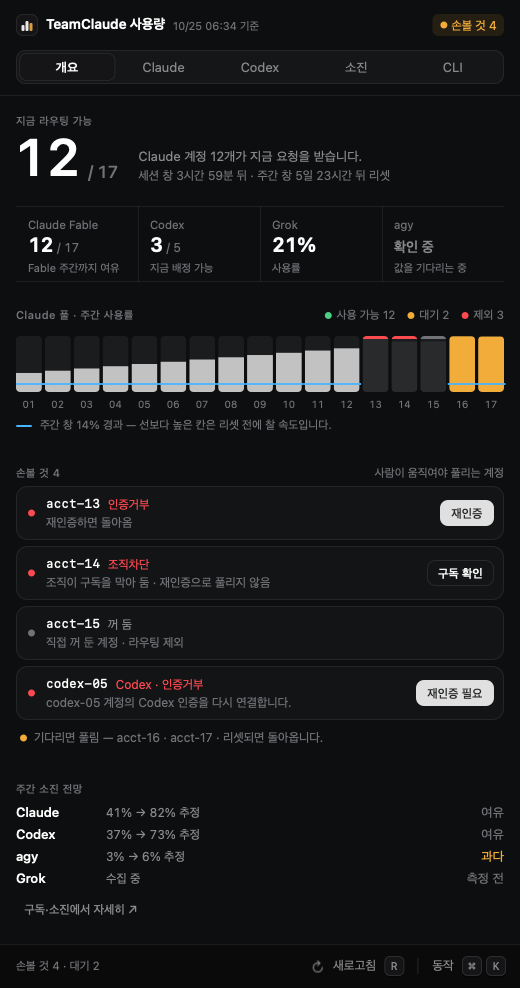
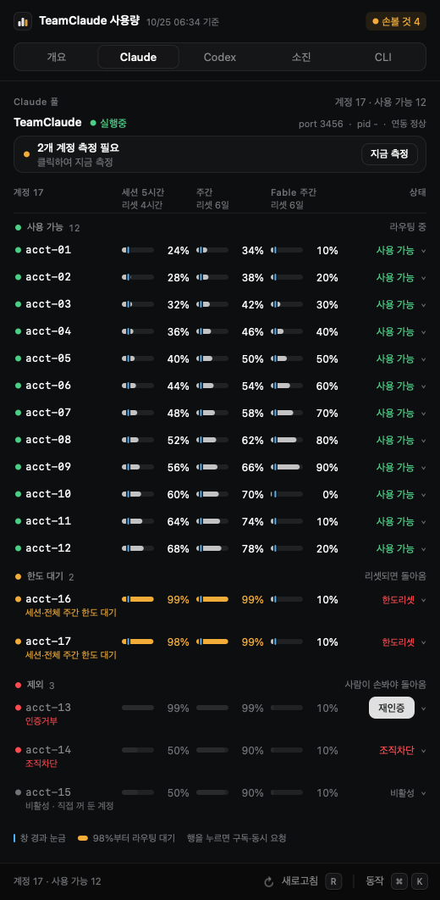

<p align="center">
  <a href="README.md">English</a> ·
  <strong>한국어</strong>
</p>

# CC Menubar

TeamClaude·TeamCodex의 macOS 메뉴바와 클릭 사용량 패널입니다.
서버·TUI와 함께 이 저장소에서 관리합니다. 별도 데스크톱 앱은 필요하지 않습니다.
Swift/AppKit 네이티브 실행 파일이며 Electron, Tauri, React, npm 런타임 패키지를 사용하지 않습니다.

**다운로드(베타):** [CC Menubar 0.1.0-beta.2](https://github.com/sangrokjung/teamclaude/releases/tag/menubar-v0.1.0-beta.2) · Apple Silicon·Intel 유니버설 · macOS 13 이상. 설치는 [외부 사용자 설치](#외부-사용자-설치)를 보세요.

<p align="center">
  
  
</p>

## 패널

메뉴바 아이콘을 누르면 폭 520pt 패널이 열립니다. 맨 위에 제목과 기준 시각, 사람이 손봐야 하는 계정 수("손볼 것 N")가 있고,
그 아래 탭 다섯 개가 있습니다. 패널 높이는 개요 탭에 맞춥니다(본문 최소 400pt, 화면 높이 이하). 계정이 많은 Claude 탭처럼 더 긴 탭은
본문 안에서 스크롤합니다. 메뉴가 열려 있는 동안에는 높이가 바뀌지 않습니다.

| 탭 | 내용 |
|---|---|
| 개요 | 지금 라우팅 가능한 계정 수, 레인 4개(Claude Fable·Codex·Grok·agy), Claude 풀 주간 사용률 띠, 손볼 것, 주간 소진 전망 |
| Claude | 상태별로 묶은 계정 표. 리셋은 열 머리에 한 번. 행을 누르면 구독·동시 요청·누적 요청·창별 리셋과 재인증·측정·구독 기록이 펼쳐집니다 |
| Codex | TeamCodex 계정 풀(계정마다 5시간·7일 막대와 리셋), 되돌리기 버튼, 이 맥의 Codex 사용량 |
| 소진 | 구독 지출과 서비스별 판정, 먼저 할 일, ccusage 사용량(비용) |
| CLI | Grok·agy 쿼터, Higgsfield 크레딧, 값이 없을 때 쓰는 말 |

막대는 98% 라우팅 문턱부터 호박색이고, 하늘색 세로 눈금은 창이 지난 비율입니다. 채움이 눈금보다 앞서면 그 창은 리셋 전에 찹니다.
하단 막대에는 새로고침(R)과 동작 목록(⌘K)이 있습니다. 동작 목록에서 계정 측정, Claude Code 계정 가져오기, Claude·Codex OAuth 계정 추가,
TeamClaude 서버 재시작, 로그인 시 열기(.app 배포본만), 종료를 실행합니다. 숫자 키 1–5는 탭을 옮깁니다.
화면 규칙(색·글자·간격)은 [DESIGN.md](DESIGN.md)에 있습니다.

## QA 훅

QA 훅은 기본적으로 꺼져 있습니다. 로컬 QA 세션에서만 켜십시오.
앱은 현재 사용자가 소유한 이 폴더가 `0700`이고 `ENABLED` 파일이 있을 때만 요청을 처리하며, 그 밖에는 요청 파일을 무시합니다.

```sh
menubar/qa.sh enable
menubar/qa.sh run                  # 또는: menubar/qa.sh run steps.json
menubar/qa.sh disable
```

결과는 `~/Library/Application Support/cc-menubar/qa/out/<id>/` 아래에 저장됩니다. 캡처는 AppleScript·접근성 권한·화면 기록 권한 없이 실행 중인 패널을 직접 렌더합니다. PNG에 계정 정보가 담길 수 있으므로 공유할 때 주의하십시오.

## 언어

화면 문구는 한국어와 영어로 나옵니다. 시스템 설정의 선호 언어 첫 항목이 한국어면 한국어, 아니면 영어입니다.
문구는 `Sources/L10n.swift` 한 곳에 있습니다. 시험할 때는 환경변수로 고정할 수 있습니다.

```sh
CC_MENUBAR_LANG=en menubar/.build/cc-menubar --dashboard-snapshot <status.json> /tmp/panel.png
```

## 개발과 설치

Apple Silicon macOS 13+, Xcode Command Line Tools(Swift), Python 3가 필요합니다.
저장소 루트에서 실행합니다.

```sh
npm run menubar:test
npm run menubar:build
npm run menubar:install
# 이미 검증한 빌드를 설치할 때
npm run menubar:install -- --binary "$PWD/menubar/.build/cc-menubar"
```

`menubar:build`는 테스트와 스냅샷을 통과한 후보만 `menubar/.build/cc-menubar`로 저장합니다.
스냅샷은 표 렌더, 도구가 없는 빈 HOME(탭마다 미설치 안내), 언어(영어 화면 한글 0자·한국어 화면 A안 문구) 세 가지입니다.
운영 앱은 바꾸지 않습니다. 설치는 기본 `~/Applications/cc-menubar/cc-menubar`에
백업 후 원자 교체하고 `com.qjc.cc-menubar` LaunchAgent를 등록합니다.
이 경로는 개발 checkout과 독립적이므로 과거 브랜치를 빌드해도 운영 화면이 바뀌지 않습니다.
기존 계정 설정·키체인·사용량 캐시·UserDefaults는 유지합니다.

테스트 러너는 기존 단언이 한국어 문구를 보므로 `CC_MENUBAR_LANG=ko`로 고정해 돕니다.
호스트 부하가 높은 환경에서는 테스트/빌드를 조직의 qgate 또는 격리된 macOS 워커에서 실행하세요.
메뉴바 설치는 GUI 로그인 중인 해당 Mac에서 실행합니다. 프록시는 재시작하지 않습니다.

패널을 눈으로 확인할 때는 오프스크린 스냅샷을 씁니다. 탭마다 한 장씩 그리고, 그려진 글자를 `TEXT <탭>=` 줄로 출력합니다.

```sh
python3 menubar/Tests/make_dash_fixture.py /tmp/fixture.json --codex
menubar/.build/cc-menubar --dashboard-snapshot /tmp/fixture.json /tmp/panel.png            # 탭 다섯 장
menubar/.build/cc-menubar --dashboard-snapshot /tmp/fixture.json /tmp/panel.png --tab claude --expand acct-13
```

## 외부 사용자 설치

GitHub Releases에서 받는 배포본입니다. macOS 13 이상, Apple Silicon·Intel 공용(유니버설)입니다.
애플 개발자 서명·공증을 하지 않은 앱이라 처음 한 번은 직접 열어 줘야 합니다.

1. Releases에서 `CC-Menubar-<버전>-macos-universal.zip`과 같은 이름의 `.sha256` 파일을 받습니다.
   같은 폴더에서 `shasum -a 256 -c CC-Menubar-<버전>-macos-universal.zip.sha256`이 `OK`면 받은 파일이 맞습니다.
2. zip을 풀고 `CC Menubar.app`을 응용 프로그램(`/Applications`) 폴더로 옮깁니다.
3. 처음 실행은 Finder에서 앱을 우클릭 → 열기 → 열기를 누릅니다.
   "손상되었기 때문에 열 수 없습니다"가 뜨면 터미널에서 격리 표시를 지우고 다시 엽니다.

   ```sh
   xattr -dr com.apple.quarantine "/Applications/CC Menubar.app"
   ```

4. 패널 하단의 "동작 ⌘K" 목록에서 "로그인 시 열기"를 누르면 로그인할 때 자동으로 뜹니다.
   `~/Library/LaunchAgents/dev.teamclaude.cc-menubar.plist`를 만들고, 다시 누르면 지웁니다.
   이 항목은 `.app` 배포본에서만 보입니다. 위 `npm run menubar:install` 내부 설치와는 별개입니다.

### 도구가 없을 때

탭마다 쓰는 도구(TeamClaude, TeamCodex, Codex CLI, Higgsfield, ccusage, Grok, Antigravity CLI)가 없으면
그 카드는 오류 대신 "미설치" 또는 "데이터 없음" 안내를 그리고, 메뉴바 제목에도 올리지 않습니다.
구독 확인 수집기는 선택 기능이라 상태 파일이 없으면 소진 탭에 "수집기 미설치(선택 기능)"로 표시합니다.

메뉴바 앱은 셸 PATH를 물려받지 않아 실행 파일을 직접 찾습니다. 순서는 다음과 같습니다.

1. 환경변수 재정의 `CC_MENUBAR_<도구>_BIN` (값이 틀리면 다른 위치로 넘어가지 않고 미설치로 표시)
2. 내부 설치가 쓰던 기존 후보 경로
3. 로그인 셸 `/bin/zsh -lc 'command -v <도구>'` (2초 제한, 앱 실행 동안 결과를 기억)
4. Homebrew(`/opt/homebrew/bin`, `/usr/local/bin`) → npm 전역 prefix → fnm·nvm·Volta 기본 별칭 → `~/.local/bin`

도구가 있는데 미설치로 뜨면 경로를 직접 지정합니다. 시작 로그에 도구별 탐색 결과가 `TOOL <이름>=<경로>` 한 줄씩 남습니다.

| 환경변수 | 대상 |
|---|---|
| `CC_MENUBAR_TEAMCLAUDE_BIN`, `CC_MENUBAR_TEAMCODEX_BIN` | teamclaude, teamcodex CLI |
| `CC_MENUBAR_NPX_BIN` | ccusage를 실행할 npx |
| `CC_MENUBAR_HIGGSFIELD_BIN`, `CC_MENUBAR_GROK_BIN`, `CC_MENUBAR_AGY_BIN`, `CC_MENUBAR_CLAUDE_BIN` | 각 CLI |
| `CC_MENUBAR_TEAMCLAUDE_PORT`, `CC_MENUBAR_TEAMCODEX_PORT` | 설정에 포트가 없을 때의 기본 포트(3456, 3457) |
| `CC_MENUBAR_TEAMCLAUDE_LABEL` | TeamClaude 프록시의 launchd 라벨(기본 `com.qjc.teamclaude`) |
| `CC_MENUBAR_LANG` | 화면 언어 고정(`ko` 또는 `en`, 시험용) |

Finder에서 띄운 앱은 셸 환경변수를 보지 못합니다. `launchctl setenv CC_MENUBAR_GROK_BIN /경로/grok`처럼 넣고 앱을 다시 열거나
(재부팅하면 사라짐), 로그인 항목 plist의 `EnvironmentVariables`에 적습니다.
launchd 라벨은 `defaults write dev.teamclaude.cc-menubar teamClaudeLaunchdLabel <라벨>`로도 바꿀 수 있습니다(환경변수가 우선).
라벨이 launchd에 등록돼 있지 않으면 "TeamClaude 서버 재시작"은 kickstart를 쓰지 않습니다.
서버가 꺼져 있으면 `teamclaude server`를 백그라운드로 띄워 시작만 하고, 이미 실행 중이면 건드리지 않습니다.

### 배포본 만들기(관리자)

```sh
bash menubar/package-app.sh 1.0.0
```

arm64·x86_64를 따로 컴파일해 `lipo`로 합치고 `menubar/.build/CC Menubar.app`, `menubar/.build/dist/*.zip`, `*.sha256`을 만듭니다.
ad-hoc 서명(`codesign -s -`)만 합니다. `menubar-v<버전>` 태그를 올리면 `.github/workflows/menubar-release.yml`이
테스트, 패키징, Release 초안(draft)까지 만들고, 공개 전환은 사람이 합니다.
태그 없이 Actions 화면의 workflow_dispatch로 돌리면 아티팩트만 만들고 Release는 만들지 않습니다.

## 관리 범위

- `Sources/`: 메뉴바·패널(개요·계정 풀·사용량·구독·소진 전망)·문구 표
- `DESIGN.md`: 패널 화면 규칙(시각 기준)
- `Tests/`, `run-tests.sh`: Swift/Python 회귀 검사와 스냅샷
- `../scripts/subscription-monitor.py`, `subscription-monitor-browser.js`: 선택적인 구독 확인 수집기
- `build.sh`, `install.sh`: 독립 빌드와 설치
- `package-app.sh`: 외부 배포용 유니버설 `CC Menubar.app`(zip·sha256)

계정 데이터는 기존 `~/.config/teamclaude.json`, `~/.config/teamcodex.json`과 로컬 서버 상태를 읽습니다.
외부 CLI(Grok, Agy, Higgsfield, ccusage)는 해당 기능에만 사용되며 데스크톱 앱과 무관합니다.
구독 수집기는 기존 브라우저 도구와 qgate를 필요로 하는 선택 기능이며 메뉴바 설치가 자동 실행하지 않습니다.
기존 수집기 LaunchAgent가 옛 저장소를 가리킨다면 그 `ProgramArguments`의 스크립트 경로와
`WorkingDirectory`를 이 저장소로 함께 옮겨야 합니다. 사용자 메일함 라이브 검사는 기본 실행하지 않습니다.

## 이관 출처와 검증 한계

`sangrokjung/cc-visualizer` 커밋 `ff70e27742208d4eea0900e98945abcc9810d9fa`의
`menubar/` 및 두 구독 수집 스크립트에서 이관했습니다. 원 개발자: Sangrok Jung.
현재부터 메뉴바 변경의 정본은 이 저장소입니다. 원 저장소의 데스크톱 앱은 이 프로젝트의 빌드·배포 대상이 아닙니다.

기존 러너는 availability의 초/일 경계 검사와 과거 로컬 QA 해시 검사 두 메서드를
known-red로 별도 집계합니다. 외부 메일함 검사는 opt-in입니다. 이관하면서 예외 목록이나 assertion을 넓히지 않습니다.

패널 단축키(R·1–5·⌘K)는 메뉴가 열린 동안 키 등가를 가진 높이 1pt 메뉴 항목으로 받습니다. 메뉴 추적 중에는 커스텀 뷰가
키 이벤트를 받지 못하기 때문입니다. 오프스크린 스냅샷으로는 이 경로를 검증할 수 없으니 실제 메뉴에서 확인하세요.
